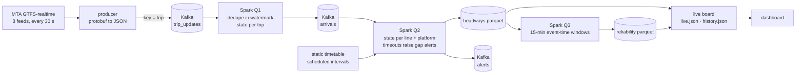

# Subway Line Watch: real-time NYC subway gaps and bunching


**Live board: [madhubuddaraju.github.io/nyc-subway-live](https://madhubuddaraju.github.io/nyc-subway-live/)**

## The problem

Riders usually find out a line is in trouble when they're already on the platform, and official alerts often trail
what is happening on the tracks. The trains themselves report where they are every 30 seconds, so delays can be
detected directly, as they form.

## What this does

A streaming pipeline reads the MTA's real-time feeds for every subway line and, for every platform:

- **infers each train's arrival** from its live predictions,
- **measures the interval between trains** and compares it with the timetable for that platform, line and hour,
- **flags gaps** (no train for twice the scheduled interval, and at least 8 minutes beyond it) and **bunching**
  (trains arriving two minutes or less apart on a line scheduled every four minutes or more),
- **raises an open-gap alert before the late train arrives**, which is when a rider on the platform needs it,
- **scores each line** with the MTA's own measure, wait assessment: the share of intervals within 25% of schedule.

The board shows every line's status, the gaps open right now ("No northbound A at 59 St for 17 min, due every 6"),
and a reliability-by-hour grid built up from every session, so a commuter can see when their line is dependable.

## First live session

Thursday 15 October 2026, 1:18 to 1:38 pm, all lines, from the real feeds:

| | |
|---|---|
| Train updates processed | about 1,400 a minute (each carries ~22 predicted stops, so ~31,000 stop predictions a minute) |
| Intervals measured | **2,152** across 25 lines and shuttles |
| Within 25% of schedule (wait assessment) | **81%** overall; weakest: 7 (66%), 6 (68%), 4 (69%); strongest: Q (97%), W (94%), J (92%) |
| Bunched trains | **74** intervals of two minutes or less on lines scheduled every 4+ minutes |
| Service gaps | **12** completed, plus open gaps such as 13 minutes without a northbound 7 at three consecutive Queens stations (scheduled every 5) |

The MTA's own target for wait assessment is in the high 70s to 80s percent, so 81% midday is in a believable range.
Each hourly session adds to the reliability-by-hour grid on the board.

## Architecture



## Streaming design decisions

**Arrivals are inferred, not given.** GTFS-realtime tells you where each train expects to be, not when it actually
arrived. Q1 keeps each train's remaining stops as state; when a stop drops off the list, the train has arrived
there, at its last predicted time. A stop that disappears while still minutes away is a reroute, not an arrival,
so it only counts if the train was due within 90 seconds.

**Two stateful stages joined by a Kafka topic.** Arrivals are keyed by train, headways by line and platform. Rather
than chain two stateful operators in one query, Q1 writes `arrivals` to Kafka and Q2 reads it. Each stage
checkpoints separately and can be replayed or scaled on its own, and other consumers can read arrivals too.

**Alerts from event-time timeouts.** A gap is most useful before the next train arrives. Q2 sets a timeout on each
platform's state for the moment the wait becomes a gap; if no train has come by then, the timeout fires and raises an
open-gap alert, refreshed every 2 minutes until a train closes it. The first version used processing-time
(wall-clock) timeouts, and the first live session showed why that is wrong: when the arrival stage fell a few minutes
behind the feed, every platform looked quiet and 48 gaps opened at once. Timeouts now run on event time: "now" is
Spark's watermark, the newest arrival actually processed minus a two-minute allowance, so a backlog delays alerts
instead of inventing them. The end-to-end test checks that an alert opens before the late train and closes after it.

**Duplicates, order and late data.** The producer keys messages by trip so each train's updates stay in order within a
partition. Q1 drops duplicate polls with `dropDuplicatesWithinWatermark`, ignores polls older than the state it holds,
and Q3 aggregates on event time with a 5-minute watermark. State lives in RocksDB.

**Checked against real data.** On the first live capture, 13% of intervals were flagged as bunched, which looked
suspicious. Replaying the capture showed each case was two different scheduled trips arriving under two minutes apart
at five or more consecutive stations: a delayed train caught by the next one, which is real bunching. The same trip
being reported twice at a platform (prediction flapping) is filtered out.

**Testable without Kafka.** The stateful rules are plain Python functions with unit tests. The Spark job takes
`--source kafka` or `--source files`, so CI runs the full three-query pipeline end to end on a simulated line, and
checks the exact intervals and statuses it produces.

## Running it

**Continuously, on one machine** (Kafka, producer, Spark and the board):

```bash
docker compose up --build
```

**On GitHub Actions** (how the public board is fed): the `Stream` workflow runs hourly with Apache Kafka as a service
container, streams for about 50 minutes and republishes the board every 4 minutes to the `live-data` branch, which the
page reads directly. Free runners can't run a 24/7 service, so there is a gap of a few minutes between sessions and
streaming state restarts each hour; history accumulates across sessions in `history.json`.

**Locally without Kafka:**

```bash
python -m venv .venv && source .venv/bin/activate && pip install -r requirements.txt
export PYTHONPATH=src
python -m subway.schedule                                   # timetable baseline
python -m subway.producer --minutes 10 --out data/capture   # record the live feeds to files
python -m subway.stream --source files --input data/capture --minutes 5
python -m subway.live                                       # build data/live/live.json
python -m pytest -q                                         # includes an end-to-end Spark run
```

## Project structure

```
src/subway/
  feeds.py      MTA feed URLs and protobuf parsing
  producer.py   polls the feeds, publishes to Kafka (or files)
  schedule.py   static timetable -> scheduled interval per platform, line, day type and hour
  logic.py      the stateful rules: arrivals per trip, headways and gap alerts per platform
  stream.py     Spark Structured Streaming: three queries joined by topics
  live.py       live board and accumulated reliability history
docs/index.html the dashboard (reads the live-data branch)
tests/          rule tests and an end-to-end Spark streaming test
```

## Data

MTA [GTFS-realtime subway feeds](https://api.mta.info/) and static GTFS timetable, used under the MTA's data feed
terms. Not affiliated with or endorsed by the MTA. Arrival times are inferred from predictions, so individual intervals
can be off by up to a minute.

## License

MIT
